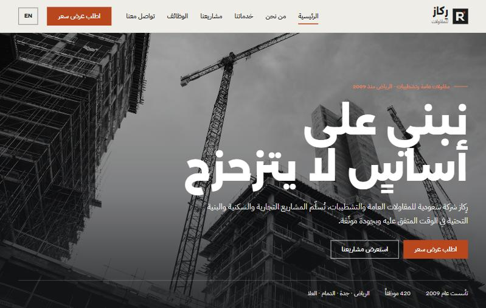
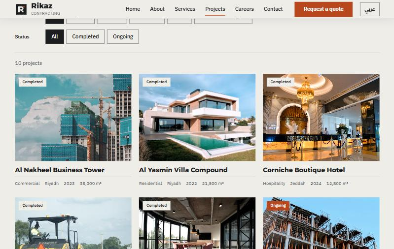
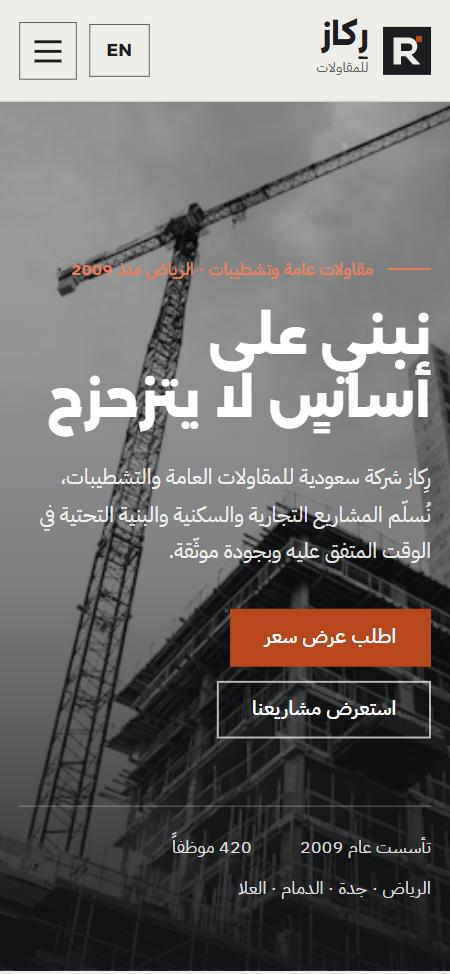
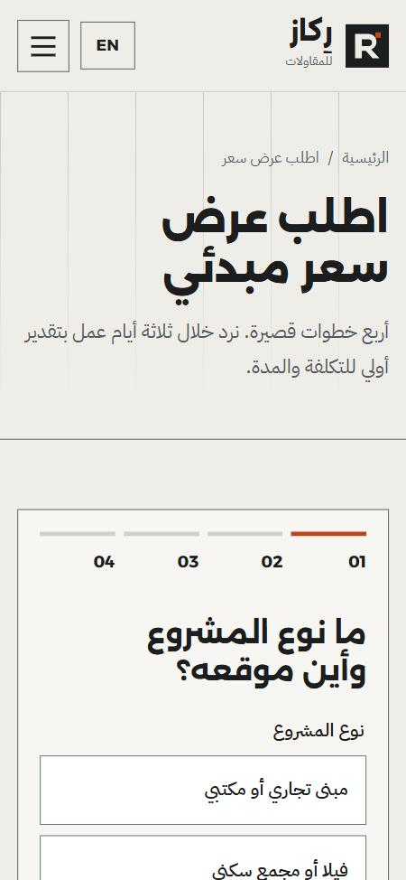

# Rikaz Contracting | رِكاز للمقاولات

A bilingual (Arabic / English) company website for a fictional Saudi contracting firm in Riyadh. Visitors can browse past projects, compare before and after photos, find sites on a map and request a quote.

موقع تعريفي ثنائي اللغة لشركة مقاولات سعودية (افتراضية) في الرياض: مشاريع سابقة، صور قبل وبعد، خريطة، وطلب عرض سعر.

**Live demo:** https://ex-vigilante.github.io/rikaz-contracting/



| Projects (English) | Phone (Arabic) | Quote form (phone) |
|---|---|---|
|  |  |  |

## The brief (case study)

**Client:** a Saudi general contracting and fit-out company, 420 staff, projects across Riyadh, Jeddah, Dammam, AlUla and the north-west region.

**Problem:** the company won work through word of mouth and printed brochures. Procurement teams in the Gulf expect to vet a contractor online first: past projects, certifications, safety record, and an easy way to request a quote, in both Arabic and English.

**Goal:** a fast, credible company site that turns visitors into **qualified quote requests**.

**Solution:**
- Arabic-first site with a full English version. The language switch keeps you on the same page.
- A project portfolio you can filter by type and city. Each project has its own page with a gallery, key facts and a **before/after slider**.
- An interactive **project map** (OpenStreetMap, no API key).
- A short **quote request** that qualifies leads up front: project type, city, size, budget and timeline, then contact details and a review. Drafts are saved if the visitor leaves.
- Trust signals: animated stats, safety record, certifications, a delivery timeline, leadership and a careers page.

## Features

- **Bilingual and RTL-correct:** separate `/ar/` and `/en/` routes, correct `lang`/`dir`, logical CSS, proper Arabic plurals (مشروع واحد، مشروعان، ٣ مشاريع) via `Intl.PluralRules`, `hreflang` and a sitemap.
- **Projects:** instant filters, accessible lightbox (keyboard, Esc, focus trap, RTL-aware arrows), before/after comparison slider.
- **Map:** Leaflet loads only when scrolled into view.
- **Quote form:** step-by-step validation, Saudi mobile numbers in any common format (05…, +966…, 00966…, Arabic digits), draft restore, reference number on submit.
- **Careers:** job filters and a validated application form.
- **Performance:** static HTML from Astro, almost no JavaScript, responsive images with fixed sizes.
- **Accessibility:** skip link, keyboard-friendly menus, visible focus, WCAG AA contrast, reduced-motion support.

## Tech stack

- [Astro 5](https://astro.build) (static output) with small vanilla TypeScript scripts
- Plain CSS with logical properties
- Leaflet + OpenStreetMap
- Fonts: Readex Pro + IBM Plex Sans Arabic
- Deployed to GitHub Pages by GitHub Actions

## Run locally

Needs Node.js 18.17+ (20 or 22 recommended). In PowerShell:

```powershell
npm install
npm run dev
```

Open the address Astro prints, then go to `/rikaz-contracting/ar/`.

To build and preview the production site:

```powershell
npm run build
npm run preview
```

## Deploy

Every push to `main` runs `.github/workflows/deploy.yml`, which builds the site and publishes it to GitHub Pages. In the repo, set **Settings → Pages → Source** to **GitHub Actions**.

## Notes

Rikaz Contracting, its people, projects and figures are fictional. Certifications are illustrative, and forms are demos that send nothing. Photos are from [Unsplash](https://unsplash.com).
